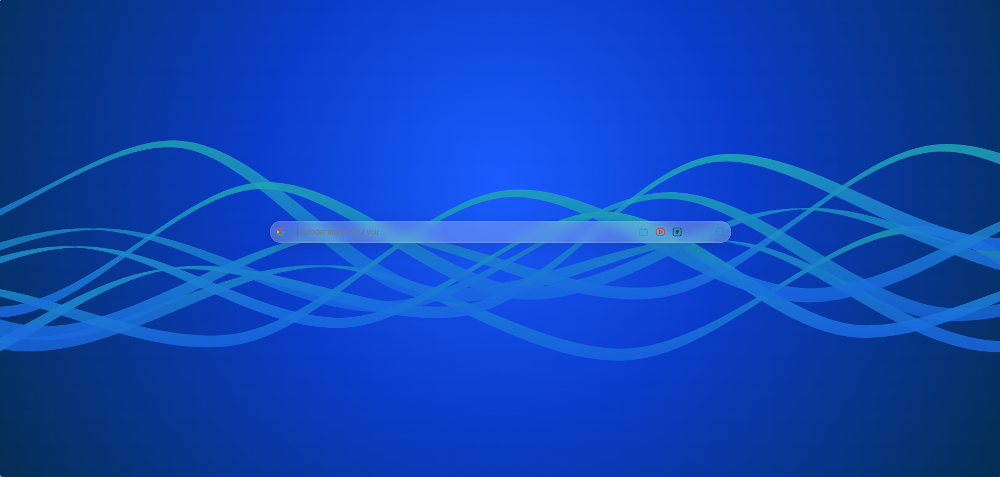
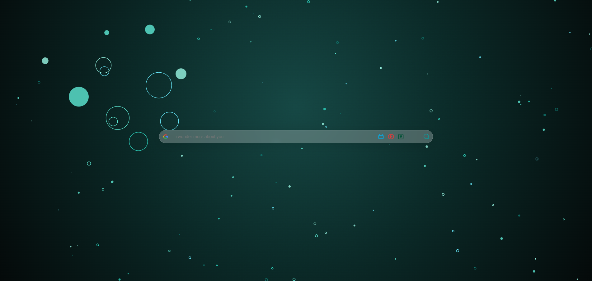
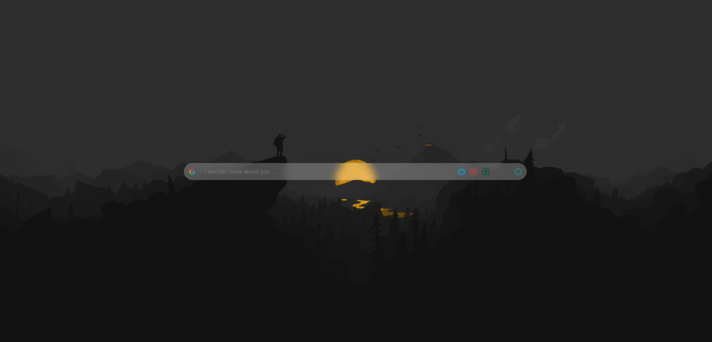
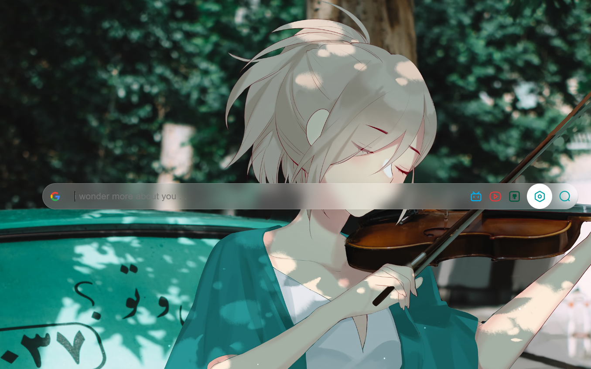
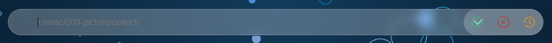
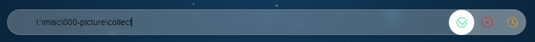
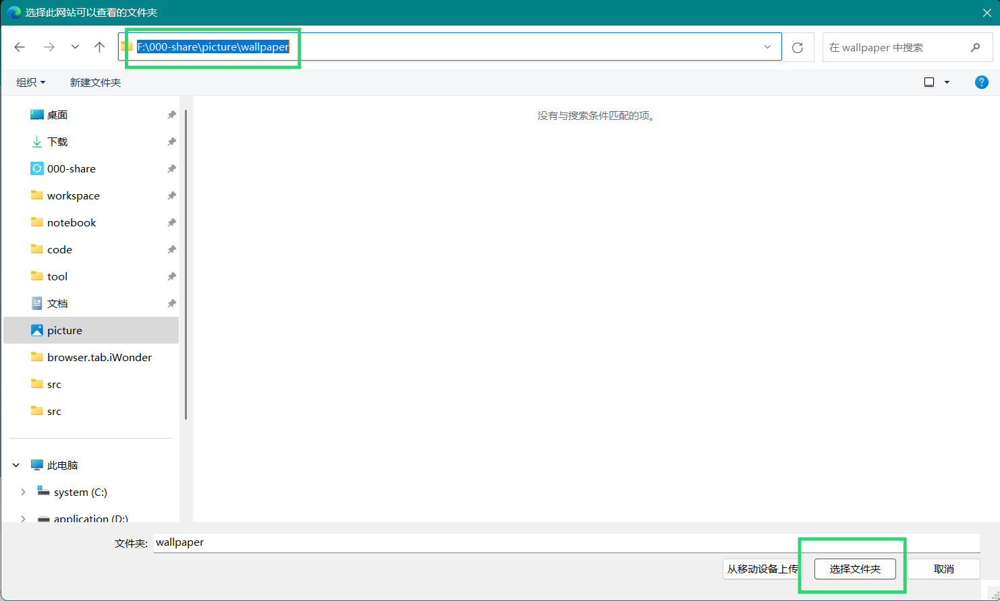
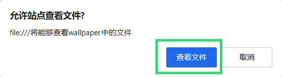

# iWonder Tab

A clean, minimalist, and responsive browser start page. Open a new tab and start searching immediately against dynamic particle/ribbon scenes or your own local wallpaper collection.

Available for Google Chrome, Microsoft Edge, and Mozilla Firefox.

[中文文档](README.md)

---

## What It Looks Like

When no local wallpaper folder is configured, a dynamic background is randomly selected from the built-in suites on every new tab launch.

### Default Ribbon Bands
Fluid, multi-layered SVG ribbons drifting gracefully across deep ambient gradients, with randomized color schemes on every reload:



### Default Omnidirectional Expanding Particles
Cosmic deep-field particle simulation with organic depth, featuring proximity-based expansion around the mouse pointer:



### Distraction-Free Interaction
Keep the UI completely quiet to appreciate the art:


Press any key (except `Esc`) or click anywhere on the blank canvas to summon the glassmorphic search bar:



---

## How to Use It

We support two primary usage modes:

### Method 1: Hosted Web Version (Zero Install)

If you prefer not to install any extensions and just want a clean start page right away, set your browser's **Home page** or **Startup page** to:

**https://iwu.world/**

| Browser | Settings Location |
| --- | --- |
| **Chrome** | Settings → On startup (Open a specific page) / Appearance (Home button) |
| **Edge** | Settings → Start, home, and new tabs |
| **Firefox** | Settings → Home → Homepage and new windows |

> **Note**: Modern Chromium browsers typically restrict web URLs from replacing the native new tab `+` button without an extension. If your browser does not allow overriding the new tab URL directly, set the URL above as your startup homepage. Note that the web version cannot access local disk folders and runs purely on the built-in dynamic backgrounds.

---

### Method 2: Browser Extension (Recommended, Full Experience)

The extension natively replaces the new tab page, opening iWonder Tab instantly upon clicking the `+` button, and grants access to local wallpaper directories.

#### 1. Download Extension Package
Head over to [Releases](https://github.com/ThymeiWonder/browser.tab.iWonder/releases/latest) and download the zip bundle tailored for your browser:

| Browser | Package to Download |
| --- | --- |
| **Google Chrome** | `itab-extension-chrome.zip` |
| **Microsoft Edge** | `itab-extension-edge.zip` |
| **Mozilla Firefox** | `itab-extension-firefox.zip` |

Extract the downloaded archive into any folder on your machine (e.g. `D:\tools\itab-extension\`). The folder contains `manifest.json` along with extension assets.

#### 2. Load into Your Browser

##### Google Chrome
1. Navigate to `chrome://extensions/` in the address bar.
2. Toggle on the **Developer mode** switch at the top-right corner.
3. Click **Load unpacked** at the top-left and select the extracted extension folder.
4. Open a new tab to enjoy iWonder Tab.

##### Microsoft Edge
1. Navigate to `edge://extensions/` in the address bar.
2. Enable the **Developer mode** toggle in the left-hand sidebar.
3. Click **Load unpacked** and select the extracted extension folder.
4. Open a new tab to begin browsing.

##### Mozilla Firefox
1. Temporary installation: Navigate to `about:debugging#/runtime/this-firefox`, click **Load Temporary Add-on...**, and select `manifest.json` inside the extracted folder.
2. File installation: Go to `about:addons`, click the gear icon at the top right, choose **Install Add-on From File...**, and select `itab-extension-firefox.zip`.

---

## Search Shortcuts & Controls

| Action | Trigger |
| --- | --- |
| **Show Search Bar** | Press any key (except `Esc`), or single-click (left or right) anywhere on blank space |
| **Hide Search Bar** | When the input is empty, press `Esc`, middle-click the bar, or right-click outside the bar |
| **Switch Engine** | Click the engine icon on the left side of the search bar to reveal the dropdown |
| **Submit Search** | Press `Enter`, or click the search magnifying glass icon on the right |

Supported search engines include **Google, Bing, Baidu, and Google AI Mode** (Google is selected by default). Your choice is persisted locally.

---

## Setting Up a Local Wallpaper Folder (Extension Exclusive)

To cycle through your own picture library alongside the dynamic background suites:

1. **Reveal the Settings Button**: Hover your mouse over the search magnifying glass on the right for ~1.5s; a gear icon will slide out:
   

2. **Open the Settings Panel**: Click the gear button to toggle the search input into the path configuration input:
   

3. **Paste Directory Path**: Copy your wallpaper folder's absolute path from your file manager (e.g., `I:\misc\000-picture\collect`), paste it into the input, and press `Enter` or click the green `confirm` checkmark:
   

4. **Confirm Folder Selection**: The system native directory picker will appear. Select the exact same directory and click "Select Folder":
   

5. **Grant Browser Permission**: When Edge asks whether to allow file viewing, click **Allow**:
   

After confirm, the extension copies those images into IndexedDB. Later new tabs read this cache only and do not touch the disk. Pick the folder again to refresh the cache. Reset clears the path and the cache.

---

## Dynamic Background Suites

- **Aurora Ribbons (`aurora`)**: Continuous Bézier ribbons flowing gently across atmospheric gradients, randomly cycling through deep ocean, twilight gold, amethyst purple, coral abyss, and emerald night palettes.
- **Dynamic Particles (`particles`)**: Depth-rich cosmic particle field with subtle film grain and radial lighting, featuring proximity-based responsive expansion.

---

## Development & Packaging

To develop locally or package distribution zip files from source:

```bash
# 1. Clone repository
git clone https://github.com/ityme/itab.git
cd itab

# 2. Local debugging
# Load `src/extension/` directly via Chrome / Edge's "Load unpacked" button.

# 3. Package extension bundles
python3 scripts/package-extensions.py
```

Running the packaging script generates distribution-ready zips inside `dist/`:
- `dist/itab-extension-chrome.zip`
- `dist/itab-extension-edge.zip`
- `dist/itab-extension-firefox.zip`
