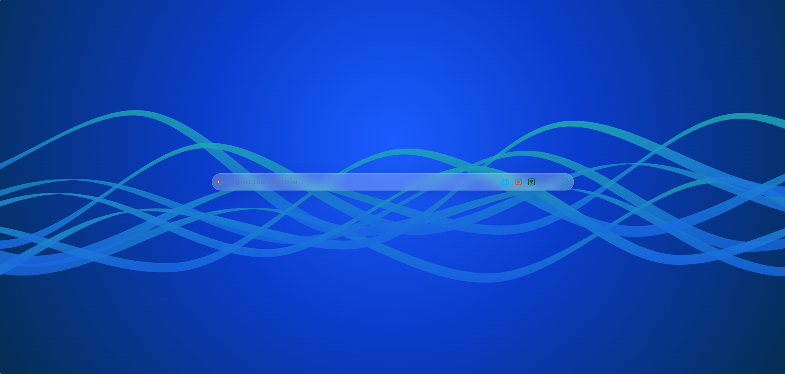
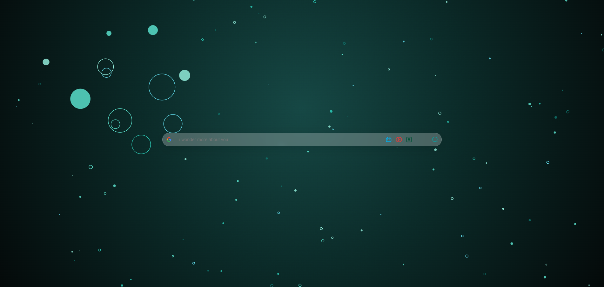
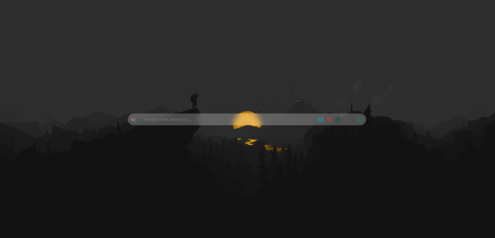
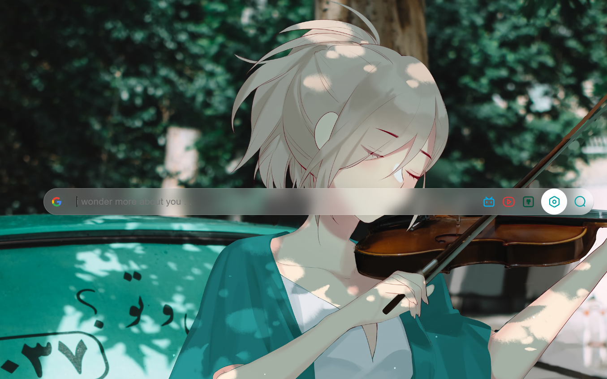
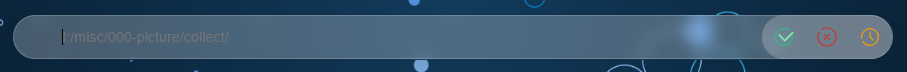
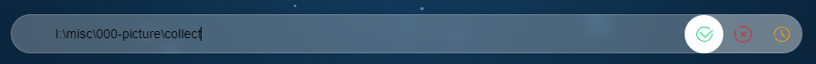
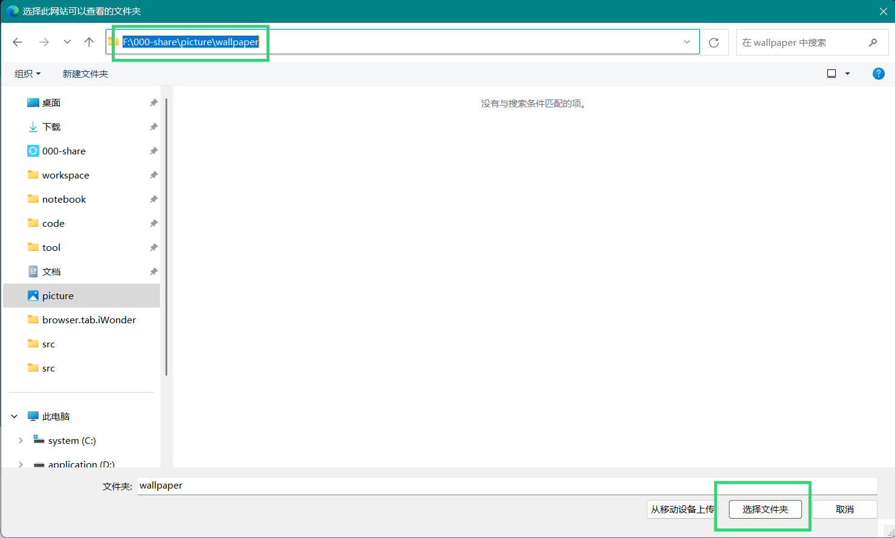
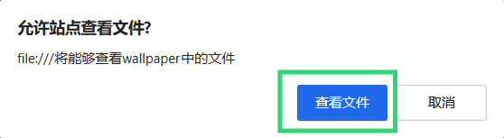

# iWonder Tab

极简、纯粹的浏览器新标签页。打开新标签即可搜索；内置灵动的动态彩带与粒子背景，亦可指定本地相册文件夹作为壁纸池。

支持 Chrome、Edge、Firefox。

[English Documentation](README.en.md)

---

## 长什么样

在未设置本地壁纸时，每次新开标签页会在内置动态背景中等概率随机展现。

### 默认动态彩带背景
深邃流体光带缓慢平移，每次打开还会随机呈现不同的色彩主题：



### 默认全向膨胀粒子背景
深空暗夜微光背景，粒子跟随鼠标指针距离产生柔和的聚散与膨胀动效：



### 极简界面交互
平时可以隐藏搜索框，沉浸欣赏背景：


按下任意按键（除 `Esc` 外），或在页面空白处单击鼠标，居中毛玻璃搜索栏即刻唤出：



---

## 怎么用

我们提供两种使用方式，您可以根据习惯自由选择：

### 方式一：直接使用远程网址（零安装）

如果您不想安装任何插件，只想立刻获得干净美观的起始页，可将浏览器的**主页**或**启动页**设置为：

**https://iwu.world/**

| 浏览器 | 设置入口推荐 |
| --- | --- |
| **Chrome** | 设置 → 启动时（打开特定网页） / 外观（主页按钮） |
| **Edge** | 设置 → 开始、主页和新建标签页 |
| **Firefox** | 设置 → 主页 → 主页和新窗口 |

> **提示**：部分浏览器（如 Chrome/Edge）原生安全策略限制了将第三方非扩展网址直接作为“点击加号新建标签页”的默认行为，因此若遇到无法覆盖新建标签页的情况，请将上述网址设置为浏览器“启动时打开的主页”。远程网页模式由于运行在 Web 作用域，无法直接读取您本地磁盘的图片目录，仅提供内置动态背景。

---

### 方式二：安装浏览器扩展（推荐，完整体验）

扩展将直接接管浏览器新标签页，每次点击 `+` 号都会秒开 iWonder Tab，并支持本地壁纸目录读取。

#### 1. 下载对应安装包
前往 [Releases](https://github.com/ThymeiWonder/browser.tab.iWonder/releases/latest) 下载对应浏览器的离线扩展包：

| 浏览器 | 推荐下载的安装包 |
| --- | --- |
| **Google Chrome** | `itab-extension-chrome.zip` |
| **Microsoft Edge** | `itab-extension-edge.zip` |
| **Mozilla Firefox** | `itab-extension-firefox.zip` |

下载后解压到任意本地目录（例如 `D:\tools\itab-extension\`），文件夹内包含 `manifest.json` 等文件。

#### 2. 载入浏览器

##### Google Chrome
1. 地址栏输入 `chrome://extensions/` 并回车。
2. 开启右上角 **「开发者模式」** 开关。
3. 点击左上角 **「加载已解压的扩展程序」**，选择刚才解压出来的文件夹。
4. 打开新标签页，即可开始使用。

##### Microsoft Edge
1. 地址栏输入 `edge://extensions/` 并回车。
2. 开启左侧菜单底部的 **「开发人员模式」** 开关。
3. 点击 **「加载解压缩的扩展」**，选择解压出的文件夹。
4. 打开新标签页即可使用。

##### Mozilla Firefox
1. 临时载入体验：地址栏输入 `about:debugging#/runtime/this-firefox`，点击 **「临时载入附加组件」**，选中解压目录里的 `manifest.json` 即可。
2. 离线文件安装：打开 `about:addons`，点击右上角齿轮图标，选择 **「从文件安装附加组件」**，选择下载的 `itab-extension-firefox.zip`。

---

## 快捷搜索操作

| 操作 | 触发方式 |
| --- | --- |
| **呼出搜索栏** | 按下键盘任意键（`Esc` 除外），或在页面空白处单击鼠标左键/右键 |
| **隐藏搜索栏** | 在输入框内容为空时按下 `Esc` 键、用鼠标中键（滚轮）点击搜索栏，或在搜索栏外部空白处右键 |
| **切换搜索引擎** | 单击搜索栏左侧的引擎图标打开菜单，选择您需要的引擎 |
| **执行搜索** | 输入内容后按 `Enter` 回车，或点击右侧搜索放大镜图标 |

内置搜索引擎包含 **Google、Bing、百度、Google AI Mode**，默认首位为 Google。切换后系统将自动持久化保存您的引擎偏好。

---

## 设置本地磁盘壁纸库（扩展专属）

如果您希望使用自己电脑中的壁纸文件夹，可以通过以下直观步骤配置：

1. **呼出设置按钮**：将鼠标悬停在搜索栏右侧的搜索放大镜图标上约 1~2 秒，左侧会自动滑出齿轮设置按钮：
   

2. **进入设置界面**：点击齿轮按钮，搜索栏将切换为设置面板：
   

3. **输入壁纸目录绝对路径**：在文件资源管理器中复制您的壁纸文件夹目录路径（例如 `I:\misc\000-picture\collect`），粘贴至输入框，并按回车键或点击右侧绿色的 `confirm` 确认按钮：
   

4. **确认文件夹授权**：系统将弹出系统的文件夹选择窗口，请再次选中刚才输入的同一个文件夹并点击「选择文件夹」：
   

5. **授予浏览器读取权限**：弹出「是否允许查看文件」时点 **允许**：
   

确认后，扩展会把该文件夹里的图片写入 IndexedDB。之后打开新标签只读这份缓存，不再访问磁盘。换文件夹需再授权一次。点 reset 会清掉路径和缓存。

---

## 背景套件说明

- **极光彩带 (`aurora`)**：多层流体贝塞尔波浪缓慢飘移交织，每次加载随机抽取深海、暮金、紫雾、珊瑚或翡翠等配色。
- **动态粒子 (`particles`)**：带有轻微胶片微颗粒与深色景深径向底衬的星空粒子系统，随鼠标指针位置感应缩放。

---

## 开发者与源码构建

如需基于源码进行二次开发或本地调试：

```bash
# 1. 克隆代码仓库
git clone https://github.com/ityme/itab.git
cd itab

# 2. 本地调试
# 在 Chrome / Edge 扩展页面直接「加载已解压的扩展程序」，选择本项目的 src/extension/ 目录即可。

# 3. 本地打包全平台扩展 Zip
python3 scripts/package-extensions.py
```

执行打包脚本后，将在 `dist/` 目录下生成各平台独立专用的离线扩展包：
- `dist/itab-extension-chrome.zip`
- `dist/itab-extension-edge.zip`
- `dist/itab-extension-firefox.zip`
